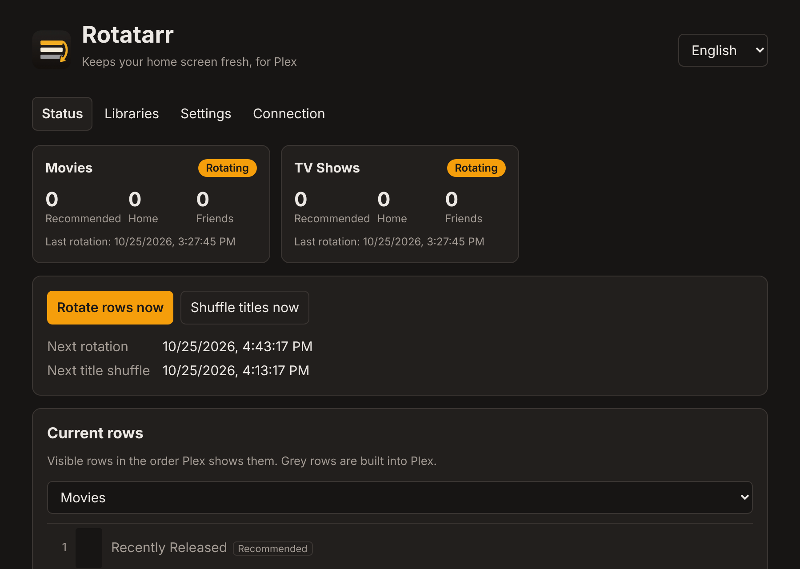
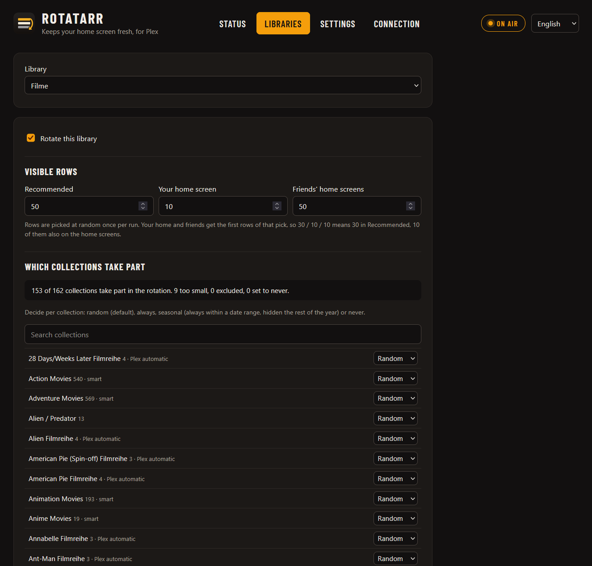
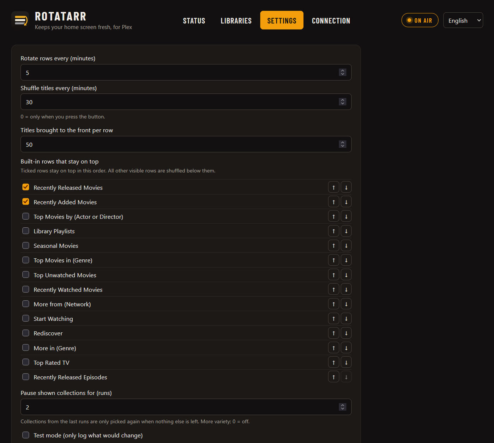

<p align="center"></p>

<h1 align="center">Rotatarr</h1>

<p align="center"><b>Keeps your home screen fresh, for Plex.</b></p>

Plex shows the same collection rows in the same order every day. Rotatarr turns your collections into a rotating program, a bit like a streaming service.

<p align="center"></p>

## What it does

- **Rotates rows:** shows a random selection of your collections in *Recommended*, on *your home screen* and on *your friends' home screens*, and hides the rest.
- **Shuffles:** the row order and the titles inside the rows. Built-in rows such as *Continue Watching* stay on top.
- **Follows your rules:** always, never or seasonal per collection (e.g. *Halloween* only in October), plus limits and a minimum size. Plex's automatic movie collections are recognised in any language, so you can limit them separately.
- **Works with any collections:** Kometa, Plex's automatic movie collections or your own.

Rotatarr only changes visibility and order. It never deletes or edits collections, and one button puts everything back.

| Collection rules | Settings |
|---|---|
|  |  |

## Install

**Unraid:** search for *Rotatarr* in the *Apps* tab.

**Docker Compose:**

```yaml
services:
  rotatarr:
    image: ghcr.io/ehnkode/rotatarr:latest
    ports:
      - "7373:7373"
    volumes:
      - ./config:/config
    environment:
      - TZ=Europe/Berlin
    restart: unless-stopped
```

Then open `http://<server>:7373`, sign in with Plex and enable your libraries.

<details>
<summary>Environment variables</summary>

| Variable | Default | |
|---|---|---|
| `PORT` | `7373` | Port of the web UI |
| `TZ` | `Etc/UTC` | Time zone |
| `PUID` / `PGID` | `99` / `100` | User and group that own the files in `/config` |
| `ROTATARR_USERNAME` / `ROTATARR_PASSWORD` | empty | Protect the web UI with a login |
| `LOG_LEVEL` | `INFO` | |

</details>

## Good to know

- Visibility and order apply to all users of your server, Plex has no per-user setting for this.
- TV apps cache the home screen. Restart the app if the new order does not show yet.
- If Kometa sets `visible_home`, `visible_library` or `visible_shared`, it overwrites Rotatarr. Let Rotatarr handle visibility instead.
- Smart collections cannot be sorted by hand. Set their sort to *random* in the smart filter instead.

**Privacy:** Rotatarr runs entirely on your own server and only talks to your Plex server and plex.tv. No telemetry.

## Development

```bash
pip install -r requirements-dev.txt
pytest
ROTATARR_CONFIG_DIR=./config python -m rotatarr
```

The backend is Python (FastAPI), the web UI plain HTML and JavaScript without a build step. Texts for the UI live in `rotatarr/static/i18n.js`; translations are welcome.

## License

[MIT](LICENSE)

---

Rotatarr is a community project and is not affiliated with or endorsed by Plex Inc. "Plex" is a trademark of Plex, Inc.
