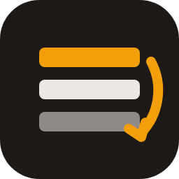

<p align="center"></p>

# Rotatarr

**Keeps your home screen fresh, for Plex.**

Plex shows the same collection rows in the same order every day. Rotatarr turns your collections into a rotating program, a bit like a streaming service:

- **Rotates rows.** From all collections of a library, a random selection is shown in *Recommended*, on *your home screen* and on *your friends' home screens*. Everything else is hidden. Each place has its own number, e.g. 30 rows in Recommended, 10 of them also on the home screens.
- **Shuffles the row order.** Built-in rows such as *Continue Watching* or *Recently Added* stay on top.
- **Shuffles the titles inside the rows,** so a row does not always start with the same posters.
- **Works with any collections:** Kometa, Plex's automatic movie collections or your own.
- **Rules:** minimum titles per collection, never show / always show lists, and limits per run (e.g. at most 10 rows from automatic movie collections, so they do not crowd out everything else).
- Web UI in English and German, *Sign in with Plex*, run now buttons, test mode, current row overview and run log.

Rotatarr only changes visibility and order. It never deletes or edits collections.

> Rotatarr is a community project and is not affiliated with or endorsed by Plex Inc.

## Install

### Docker Compose

```yaml
services:
  rotatarr:
    image: ghcr.io/ehnkode/rotatarr:latest
    ports:
      - "7373:7373"
    volumes:
      - ./config:/config
    environment:
      - TZ=Europe/Berlin
    restart: unless-stopped
```

Open `http://<server>:7373`, connect to Plex on the *Connection* tab, then enable your libraries on the *Libraries* tab.

### Unraid

Until Rotatarr is listed in Community Applications, add the template by hand: *Docker → Add Container → Template repositories*, add `https://github.com/Ehnkode/rotatarr`, or copy [`unraid/rotatarr.xml`](unraid/rotatarr.xml) to `/boot/config/plugins/dockerMan/templates-user/`.

### Options

| Variable | Default | |
|---|---|---|
| `PORT` | `7373` | Port of the web UI |
| `TZ` | `Etc/UTC` | Time zone |
| `ROTATARR_USERNAME` / `ROTATARR_PASSWORD` | empty | Protect the web UI with a login |
| `LOG_LEVEL` | `INFO` | |

## Good to know

- **Visibility and order are server-wide.** Plex applies them to all users; they cannot differ per person.
- **TV apps cache the home screen.** A new order may only show after restarting the app or switching libraries.
- **Smart collections cannot be sorted by hand.** Rotatarr skips them when shuffling titles. Set their sort to *random* in the smart filter instead (in Kometa via the template), then Plex shuffles them itself.
- **Kometa:** if Kometa sets `visible_home`, `visible_library` or `visible_shared`, it overwrites Rotatarr on every run. Let Rotatarr handle visibility instead.
- **Separator collections** with few or no titles (e.g. Kometa's "Genre Collections") are filtered out by the minimum titles setting.
- Shuffling titles needs about 20 requests per row. It is slower while Plex is busy, e.g. during a Kometa run.

## Development

```bash
pip install -r requirements-dev.txt
pytest
ROTATARR_CONFIG_DIR=./config python -m rotatarr
```

The backend is Python (FastAPI), the web UI plain HTML and JavaScript without a build step. Texts for the UI live in `rotatarr/static/i18n.js`; translations are welcome.

## License

[MIT](LICENSE)
